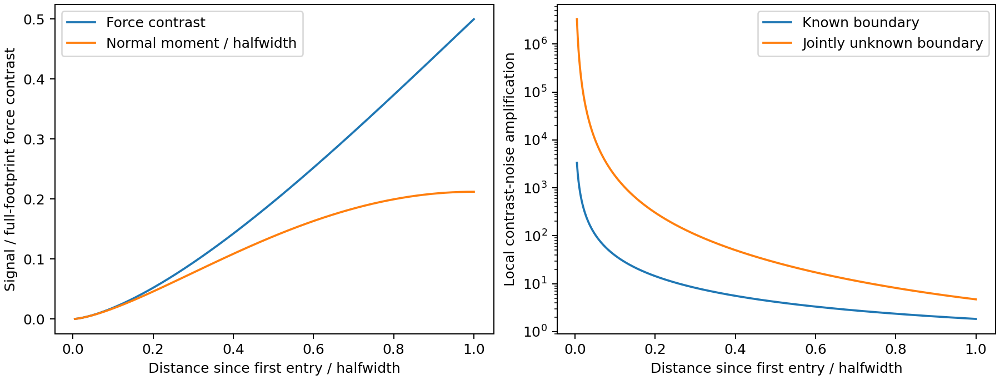

# B0问题依据的条件核查

这是理论/尺度核查，不是新控制器性能实验。解释和研究层判断见[研究现状](../../research/field_state.md)第5节。

`preview_scale_audit.py` 使用B0附录B.2、D.1、G.2，保留三项结果：部分覆盖信号与已知/未知边界下的局部条件数；中心到达之前的几何时序；固定合成几何在不同载荷下所需接触尺寸。以独立数值积分核对闭式信号。

复现：安装根目录NumPy/SciPy以及 `matplotlib==3.9.4`，运行：

```bash
python experiments/b0_problem_evidence_audit/preview_scale_audit.py
```

该脚本只需NumPy/SciPy/Matplotlib；不依赖已移除的旧PPO目录。

输出为 `results.json` 和 `footprint_information.png`。图中力矩已除以半宽，信息条件数采用等归一化独立噪声，仅用于显示结构；真实力矩/力噪声比例必须另行标定。

源码/JSON第二个信号通道保留传感器坐标符号，是法向力对M_y的贡献，即附录一阶矩m_1的负值；图中显示其幅值。



横轴0至1表示前缘初触到探头中心到达材料边界，并非整个接触斑已完全进入新材料。

本例假定接触半宽和原区域材料已知、法向一阶矩能从完整力矩中分离。没有运行未知摩擦/表面运动/偏置的完整MHE，没有力/力矩传感器标定，没有测量组织响应。载荷表只是扫描合成几何的适用尺度，不是临床力限值，也不证明所用空间压力近似正确。相关退化已在B0附录声明，本轮不将其包装成新贡献或研究问题。
