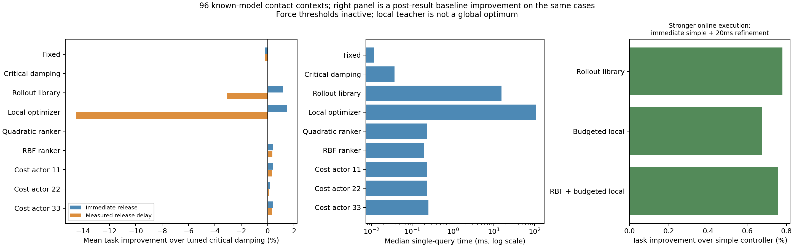

# 实际接触与能量执行下，快速阻抗更新是否值得？

2026-10-18。比较版本 `ed3a3299f5baf855685665bcf5d70226e759f0c4`。这是围绕原问题的两轮探索性方法验证，不是完整B0、实机结果或已经成立的论文贡献。

## 要判别什么

上一组线性预载/期望代价实例中，优化收益小，发布延迟又吃掉收益。本组加入切向/法向滑动、单边非线性法向接触、四个实际增益、速率和能量账本，检验在线模型优化与学习生成阻抗是否比调优简单调度更有价值。条件来自原接口，不在看到结果后加大扰动或收紧约束制造优势。

两轮结果仍未支持顶刊方法贡献：学习改善了时效，但普通RBF相近或更好，任务增量很小。接触/力限制未触发，不能声称已检验复杂接触条件下的优势。

## 模型、信息与目标

`model.py`独立实现两个平移轴，实际增益为切/法向K/D。法向力为

\[
F_n=3[\max(\delta,0)/\delta_d]^{3/2},\quad \delta_d=4.5/k,
\qquad F_t=\mu F_n\tanh(v_t/0.002).
\]

该3/2次单边弹簧**不是B0柱面Hertz有限足迹**，没有法向矩、空间材料场、MHE或完整机器人。局部斜率k在300–1500N/m，摩擦系数0.1–0.6，目标力3N，切向速度8mm/s。状态为两个位置误差、两个速度误差、四个实际增益、能量；质量0.8/0.5kg。初始压入由旧斜率得到，旧/新斜率比0.75–1.25；初始增益/误差/账本共同采样。只有更新后的0.3秒过渡，期间模型固定、未来没有随机扰动。

**全部方法共享精确当前状态、更新模型和能量**。这是理想信息层，不表示环境认识已解决；不把旧/新系数采样冒充持续扫描或部署级估计。初始参考/储能状态给定，不核算此前辨识、参考切换或接触建立的完整过程。

机器人执行前馈＋阻抗反馈，实际作用饱和于±12N。累计代价只含位置、速度、接触力误差与实际控制作用变化；归一化尺度和权重见`flow()`，没有增益偏好、信息奖励或成像代理。优化两个常值目标段，经共同低层驱动实际增益，而非瞬时跳变K/D。

增益范围K=5–1600N/m、D=2–120Ns/m，速率800N/m/s与80Ns/m/s。能量过滤器是原式(31)的简化反馈投影：

\[
\dot E=\chi P_D-\tfrac12(e_t^2\dot K_t+e_n^2\dot K_n),\quad
\tfrac12(e_t^2\dot K_t+e_n^2\dot K_n)\le\chi P_D+\alpha(E-E_{\min}).
\]

\(\chi=0.5,\alpha=40/s,E_{\min}=10^{-5}J\)。求增益率盒与半空间的欧式投影；零动作可行。连续精确执行时，\(\dot{(E-E_{\min})}\ge-\alpha(E-E_{\min})\)，故可保持账本下界；增益幅值用同类条件。数值执行须另核误差。这是成熟约束/能量核算，不是新定理或B0整套证明的继承。

移动参考、前馈及环境变化的功率不能忽略；本组没有由账本下界推导机器人总无源、渐近稳定或硬力安全。0.2–6N是**仿真诊断范围**，不是临床限制，也未作为已保证的轨迹约束。

## 第一轮：优化、模仿与强简单方法

`screen.py`先写`protocol.json`，使用192训练、48验证、96测试（种子7201/7202/7203）。固定目标与临界阻尼调度均在训练实例优化；后者按环境斜率改变法向K/D。小库包含保持旧值、两种调优简单目标、27组刚度/阻尼比组合，共30个目标，经完整相同执行层预测后择优。

两段局部数值优化以库最优解初始化，用L-BFGS-B、相同物理目标和边界；不称全局最优。336条中333条报告收敛，未收敛记录和保留起点规则均保留。以同一优化标签训练三个状态条件网络和RBF；原PPO未重训。

下表是各测试实例相对代价改善的平均，**正数更好**；均相对调优固定目标：

| 方法 | 立即发布改善 | 计入本机实测发布延迟后 | 单次中位时间 |
|---|---:|---:|---:|
| 调优临界阻尼调度 | 0.587% | 0.579% | 0.040ms |
| 30目标预测库 | 1.515% | −2.005% | 15.44ms |
| 两段局部数值优化 | 1.837% | −10.313% | 74.53ms |
| 直接模仿目标的三网络 | 0.231%–0.309% | 0.218%–0.298% | 约0.047–0.051ms |
| 模仿目标的RBF | −1.789% | −1.795% | 0.039ms |

优化时间含用于初始化的小库预测；标签生产与训练时间另记。库＋网络再预测选择只增加很小的无延迟收益，计延迟后仍更差。结论限本实例与本实现，不是RTI、稀疏求解器或完整B0的极限。

## 方法迭代：学习任务代价而非目标增益

同一个实际增益轨迹可以对应不同目标。若能量限制不激活，且一个分量的目标满足
\(g_d-g_0\ge\bar r(T+\tau_g)\)，低层\((g_d-g)/\tau_g\)在整个时域都饱和为\(\bar r\)。两个足够大的目标虽然不同，实际执行完全相同。本组构造例中K目标差72N/m、D差7.2Ns/m，累计代价与最终状态差均为零。它说明增益标签误差不等于决策损失；不据此断言第一轮网络的全部误差都由该机制导致。

`ranking.py`复用相同192训练/48验证实例的**30个实际执行代价**：网络以候选分布的期望相对任务代价训练，部署选择候选；普通二次回归和RBF用同样数据预测各候选相对代价。全部超参/检查点只在验证集按任务损失选取，然后生成新96例（7503），没有继续调测试集。它是成熟任务导向学习的迁移实验，不以其组合命名新颖性。

新测试结果均相对调优临界阻尼调度：

| 方法 | 立即发布改善 | 计入本机实测延迟后 | 单次中位时间 |
|---|---:|---:|---:|
| 30目标预测库 | 1.168% | −3.092% | 15.58ms |
| 两段局部数值优化 | 1.456% | −14.547% | 110.36ms |
| 二次代价回归 | 0.050% | 0.003% | 0.232ms |
| RBF代价回归 | 0.411% | 0.372% | 0.198ms |
| 任务代价网络，三个种子 | 0.191%–0.400% | 0.141%–0.352% | 0.232–0.252ms |

新96条局部数值优化有95条报告收敛。神经网络没有相对RBF的可靠优势：种子11/33与RBF之差的配对区间跨零，种子22更差。相对简单调度，RBF改善的实例重采样95%区间约[0.150%,0.615%]，三个网络分别约[0.154%,0.583%]、[−0.001%,0.312%]、[0.136%,0.560%]。区间仅对这族合成实例的重采样，不含机器人、模型误差、任务或材料迁移不确定性；不将三个训练种子当三组物理试验。



计时为单线程、暖缓存、随机方法顺序的本机单次调用，含特征/候选构造及选择，非批量吞吐、WCET或实机实时保证。每方法先保持旧实际增益，完成计算后再执行原计划，精确处理亚毫秒发布时刻；不是时延补偿RTI，也未做滚动重规划。不能把这些负延迟结果外推为所有在线优化都不如网络。

## 继续强化在线方法：先执行简单方案，再后台改进

上述旧阻抗等待是诊断，仍缺更充分的在线对照。`anytime.py`在同96例上补入成熟执行方式：立即发送临界阻尼调度目标，计算时继续执行；按共同模型预测20ms发布时的状态/实际增益/能量，仅优化剩余0.28秒。包含保持简单方案的候选，以相同任务代价择优；若工作线程超时则保留简单方案。20ms是本轮明确列出的工程诊断值，不是从文献推出的必须期限或永久验收标准。

局部优化最多四次L-BFGS-B迭代，按实测单次评估代价预留返回时间，预算到即保留已评估的最好候选；不要求先完整收敛。RBF用于热启动时，特征、预测及候选生成实际计时，不把离线输出当零耗时。所有方法共享同一实际增益/能量过滤。

| 后台改进方法 | 相对立即执行简单方案的平均改善 | 工作线程中位时间 | 本批超20ms |
|---|---:|---:|---:|
| 30目标预测库 | 0.780% | 14.17ms | 0/96 |
| 预算内局部优化，至多四步 | 0.674% | 19.27ms | 0/96 |
| RBF热启动＋预算内局部优化 | 0.758% | 19.20ms | 0/96 |

预选前两例独立DOP853最大相对代价误差2.88e−7。相同模型下包含基准并正确预测发布状态，可避免本轮旧计划等待造成的退化；这是经典候选改进/随时可用优化思想，不是我们新定理。没有真实系统模型误差下的不退化或最坏耗时保证。该补强是在看过前述结果后完成，沿用同96例，**不是第三批独立测试**。

这项正结果修正了“在线优化必然被延迟抵消”的可能误解：充分执行设计仍有收益，RBF热启动也可用。但三个方案增量均不到1%，库预测最好、网络并非必要，还不足以成为本项目所追求的顶刊贡献。不能只保留前面负延迟数字、忽略本项已实施的强化。

## 独立核查与关键边界

`verify.py`从物理常量重写方程和Brent投影，并与从零动作启动的独立SLSQP凸QP比较。64随机状态＋16个专门激活能量面的代数例：向量场/代价最大差约2.16e−10，投影1.32e−13，带显式功率项的储能恒等式差1.39e−17。激活代数例不是性能样本，不用于增加方法收益。

预选前两条测试，各方法用独立DOP853复算，第一轮最大相对代价差8.63e−7、新96例3.27e−7；另核两倍积分细化、权重重载及精确发布时刻。后台改进的独立核对另在`anytime_results.json`。检查JSON保留具体误差。

性能数据中没有接触丢失、6N越限或执行器饱和，能量过滤只在第一组固定目标的1/96例激活，第二组所列方法均未激活。**因此本组不是接触切换、受限能量或硬力边界优势的检验。** 能量面被独立代数验证，不表示它在任务中已重要。

这里强简单方案指同一阻抗执行族内的调优方案；未复现完整Xue、Haninger、Fu或Roveda，也未与允许调整参考/前馈的充分直接力反馈做同任务能力比较。性能证据不足以建立本领域新能力，更不能把小幅平均收益当顶刊科学增量。

## 保留用途与定位

四增益执行、任务代价训练、RBF和预测发布/后台改进可用于后续方法和对照。本组是已知局部模型探索，未打通候选2的MHE/空间预瞄前端；不能据此规定后续必须采用哪种训练/求解方式或贡献形式。原具体续做安排撤回，当前任务见HANDOFF。

## 复现与材料

依赖Python3.12、NumPy1.26.4、SciPy1.13.1、Numba0.68.0、Torch2.7.1+cpu；绘图Matplotlib3.9.4。

```bash
cd experiments/contact_constrained_impedance_update
OPENBLAS_NUM_THREADS=1 OMP_NUM_THREADS=1 python screen.py
OPENBLAS_NUM_THREADS=1 OMP_NUM_THREADS=1 python verify.py
OPENBLAS_NUM_THREADS=1 OMP_NUM_THREADS=1 python ranking.py
OPENBLAS_NUM_THREADS=1 OMP_NUM_THREADS=1 python audit_ranking.py
OPENBLAS_NUM_THREADS=1 OMP_NUM_THREADS=1 python anytime.py
python plot.py
```

性能计时期间不并行运行其他重计算。源码、协议、结果、两组配对数组、六个网络、普通回归权重和独立核对一起保留。重跑会覆盖本目录结果；需要新研究修改时先保留比较提交，不用旧哈希冒充新结果。
