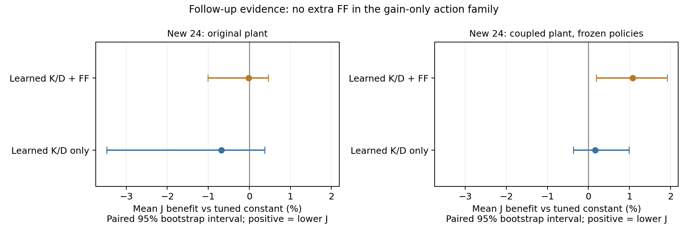

# Within-scan impedance feedback: design, iteration and rapid validation

2026-10-18. **Neither concrete prototype establishes stable substantive task advantages or leading-journal contribution.** Retain model-based, offline task-loss, pure-K/D and corrected-coupling frozen-policy results. The original question remains. Reusable estimation, execution, simple controls, offline formulas and physics corrections do not represent complete candidates1/2 or restrict future contribution forms.

## Implemented methods

**Model route.** Fit normal slope, spatial gradient and residual temporal drift from noisy delayed wrench/motion histories. Subtract known friction lever arms and approximate pressure affinely for gradient estimates, not full-field reconstruction or error-free preview. Predict about 0.192 seconds over 25 candidates, choosing K/D targets/optional normal feedforward through rate/energy execution and task loss. This is one nominal model, without original multiresponse uncertainty, full RTI release correction, HJB/NNBO/NEOC.

**Offline route.** Train small structured feedback directly on whole-scan simulation loss with established cross-entropy search, instead of nonunique optimal-K/D labels. Joint control has8 coefficients, with core form

\[
\log K_n=a_0+a_1\log(\widehat k/1000)
+a_2\tanh((\widehat F_n-F_d)/0.3)+a_7\tanh(v_n/0.01),
\qquad \log D_n=a_3+a_4\log(\widehat k/1000).
\]

K/D use this experiment's physical-unit numerical values; normalize features as shown. Remaining coefficients mix spatial/time feedforward. Pure-gain variants fix extra normal feedforward to zero and train6 coefficients. **Outputs are normal K/D targets through shared actual-gain dynamics; tangential K/D stay fixed. This is not a four-gain neural policy or PPO reproduction.** Common target-force feedforward/tangential compensation remain; pure gain means no extra normal feedforward action.

These reuse predictive control, analytical quadratic optimization and policy search. Tool names/combinations are not innovation. State dependence does not repair a supposed B0 omission: B0 already defines state feedback.

## Task and fairness

Finite-width cylindrical probe/elastic foundation with local normal-velocity damping, tangential/normal mechanics, four actual gains, bounds/rates, energy ledger and actuator limits. Not B0 heterogeneous Hertz/full robot. Related earlier foundation/contact-constrained equations are reimplemented for unknown continuous scans/information timing, without old performance reuse.

- Half-width10mm, lateral length20mm, radius50mm; scan64mm at 8/12/16mm/s, target3N. Foundation1.5–9MN/m³, random contrast/topography, motion0.15–0.35Hz. Damping scales with 2–15ms,**not long-relaxation internal-state tissue**. Exploratory ranges lack joint platform calibration.
- Noisy100Hz observations,20ms delay,25Hz gain targets,1ms mechanical/gain integration. Model, analytical and learned methods share pose, wrench, gains/history, without truth/future access. Strong initialization uses declared surface reference,3N and measured pose;1000N/m prior is a same-method sensitivity check.
- Initial3N contact and scan speed are already established. Contact establishment, patient-specific preparation and true zero calibration are untested. Ideal two-axis compensation, fixed attitude, no gravity/bias errors are not actual ultrasound performance.
- Main cost includes force, tangential/normal position, normal velocity and execution force; scales1.5mm/0.3N. Normal reference is initial position, not future tissue motion. This instantiates B0-style joint objectives,**not a unique clinically approved target**; patient-relative positioning needs reference updates. Retain separate free-following tasks, not one combined experiment.

Direct force feedback, reference compensation, analytical control and ordinary offline tuning are valid strong comparators. Static local linear contact without control cost/viscosity/integration gives the known quadratic relation
\(K_n=(1+k_p)Q_z/(Q_F\widehat k)\). Use only as a strong simple reference, not a new theorem or exact full-task optimum.

## First cohort:48 unseen scenarios

18 training/18 validation;128 fixed settings, then continuous tuning of simple, analytical/reference strategies. Conditional feedback uses280 search iterations, then140 under stronger shared initialization. **Freeze configuration/protocol before** generating48 cases,16 per family, and pair16 implementations/two initializations. Measure response-update/decision times on validation states and replay each p95 delay, excluding full I/O/OS overhead; not WCET/robot certification.

Main-task results use common strong initialization and those delays. Lower J is better; RMS is mean per scenario, peak is cohort maximum.

| Method | MeanJ | ForceRMS/N | Normal-position RMS/mm | Peakforce/N |
|---|---:|---:|---:|---:|
| Fixed gains/force feedback | 4.79579 | 0.05652 | 0.99889 | 3.3077 |
| Continuously tuned fixed gains/feedforward | 4.78854 | 0.04077 | 1.01406 | 3.2402 |
| Analytical stiffness, tuned damping/feedforward | 4.77558 | 0.04487 | 1.00628 | 3.4018 |
| Local-equilibrium reference compensation | 4.77958 | 0.04521 | 1.00891 | 3.3651 |
| Model prediction: gains/feedforward | 4.78911 | 0.04007 | 1.01140 | 3.4332 |
| Offline feedback: gains/feedforward | 4.75491 | 0.03965 | 1.00975 | 3.2229 |

- Model joint optimization has about**+0.283%** meanJ versus the sufficient analytical rule, with interval crossing zero. Lower force RMS accompanies worse position/peak; do not report force alone.
- Joint offline feedback lowers meanJ by**0.433%**, paired scenario-bootstrap95% interval**[0.261%,0.630%]**. ForceRMS0.04487→0.03965N; normal-position RMS1.00628→1.00975mm. This small checkable benefit is not an important new task capability.
- MeanJ improvement is1.179%,0.709%,0.258% for homogeneous/static, heterogeneous/static, heterogeneous/moving; the last interval crosses zero. Overall averages do not establish reliability for all changes.
- Median response/decision times: model1.067ms, analytical0.00229ms, joint offline0.00256ms. Learning beats rollout, not simple analytical control; timing alone is not a computational contribution.


## Follow-up: pure K/D learning on24 new scenarios

Joint benefits cannot be attributed to gain learning. Retrain **without extra normal feedforward** on original training/validation, tune same-action-family constant K/D/analytical rules, freeze and generate24 new cases. Old48 cases are not independent tests of this revision.

| Method | MeanJ | ForceRMS/N | Normal-position RMS/mm |
|---|---:|---:|---:|
| Continuously tuned fixedK/D | 4.64838 | 0.04084 | 0.99456 |
| AnalyticalK, tunedD | 4.78014 | 0.04933 | 0.99187 |
| Offline learnedK/D | 4.67991 | 0.04154 | 0.98930 |
| Original joint policy, not retrained | 4.64917 | 0.03807 | 0.99258 |

Pure-gain learning has**0.678% higher** meanJ than tuned fixed gains; improvement-positive interval[-3.473%,0.376%].14/24 improve, but worst excess cost is about 0.958; win counts mislead. Joint policy also lacks reliable fixed-gain advantage here. Its original analytical-rule gain remains, but is not stable across sufficient simple references/new samples.

Adding the fixed reference to old 48 cases is **post-hoc strengthening only**: joint mean is0.693% lower with interval crossing zero, not more independent tests. See `followup_analysis.json`. Force/pose tradeoffs explain cost differences; one RMS does not explain all J.

## Numerical checks and evidence limits

1. Independently reconstruct pressure integration, actuation and costs, and rerun causal controls with DOP853-generated observations. Two cases×four feedback laws give maximum relativeJ difference2.21e−5, not replayed actions.
2. Refine all 48 cases for analytical, joint-learning/model routes by4×time and33→129 pressure nodes. Joint improvement remains0.433%, interval[0.256%,0.627%], supporting resolution independence of the small benefit.
3. Thirty constructed high-pressure/tangential-error/low-energy states show large1ms/33-node differences; retain originals. Normal-task checks neither cover these boundaries nor certify safety. Refine the pure-gain cohort's worst regression and two designated cases separately.
4. No main-case contact loss, saturation or energy filtering occurs; difficult-constraint advantage is untested. One ideal model's holdouts are not cross-physics/hardware transfer. Intervals condition on trained policies, excluding training randomness.
5. Full B0 and same-task original Xue, Li, Haninger controllers remain unreproduced; comparators are declared principle implementations. Original PPO is untrained; NEOC superiority over Newton and true-optimal impedance are unproved.

### Physics audit: numerical agreement does not validate contact physics

Damping here is a **simplified local term, not complete moving Kelvin contact**. At fixed material pointX, indentation derivative includes\(\dot z+(X-s)\dot s/R-h_t\), but current damping retains only\(\dot z-h_t\), without complete tangential deformation/footprint-boundary power relations. This affects material-moment interpretation and prevents direct real-preview extrapolation.

`contact_kinematics_audit.py`: uniform medium, constant speed,3N. Adding convection leaves normal force unchanged but gives first moment0.000192Nm; direct3M/A² maps it to apparent gradient5.76N/m. Full drift observers may absorb some effect;**this does not prove whole-controller error/failure** or full-probe validity. AuSoScan already includes velocity-dependent pressure; this is not a new discovery.

### Added implementation: motion-coupled correction,24 new cases

Implement `coupled_contact.py` separately, retaining old sources/results. Pressure includes convective strain rate; tangential elastic force differentiates discrete-foundation energy in scan position including finite-window terms; viscous tangential force pairs with the same rate. Account for clipping, friction and moving-tissue power.48 random states give maximum discrete power-identity residual2.17e−11W/nonnegative dissipation: internal checks,**not full 6D probe, real tissue or closed-loop safety**. Moment channels remain ideal pressure-moment/lever-arm relations.

Freeze parameters without new-test tuning, lock protocol, generate24 cases(seeds8601/8602), run7 original controllers at 0.5ms/129 nodes:

| Method | MeanJ | ForceRMS/N | Normal-position RMS/mm |
|---|---:|---:|---:|
| Continuously tuned fixedK/D | 5.01345 | 0.04290 | 1.02610 |
| AnalyticalK, tunedD/feedforward | 4.96935 | 0.04728 | 1.01578 |
| Model prediction: gains/feedforward | 4.99662 | 0.04394 | 1.01887 |
| Offline feedback: gains/feedforward | 4.95937 | 0.04928 | 1.00389 |
| Offline learnedK/D | 5.00494 | 0.05483 | 0.99686 |

Joint learning improves fixed control1.079%, paired[0.195%,1.919%], but analytical control only0.201%,[-0.278%,0.806%].Pure gains improve fixed0.170%,[-0.368%,0.991%]; model optimization is0.549% worse than analytical. **Corrected physics still does not establish stable sufficient-simple-control superiority.** This is frozen-controller sensitivity, not fully retuned ranking. Do not merge cohorts into96 uniform tests or claim full original-method reproduction. Old timing replay is not new-model timing.

Refine the two designated cases plus worst pure-gain regression, three cases×three policies, to0.25ms/257 nodes. Maximum relativeJ change3.86e−5 supports numerical checks only, not tissue calibration.



## Reuse and corrected status

Reuse local estimation, gain execution, analytical/fixed/reference control, task-loss search and corrected physics as future baselines/carriers. CEM formulas are exploratory, not proved superior to candidate 2's full estimation/preview/offlineNN; do not report them as candidate 2. Retain all old omissions/positive/negative results; the old approximation is not validated real contact. Current requests/HANDOFF govern continuation.

## Reproduction and versions

Local `requirements.txt`/`environment.json` retain tested environments, differing from some root versions. Rebuild current results in sequence:

```bash
OPENBLAS_NUM_THREADS=1 python experiments/within_scan_impedance_feedback/iterate.py --task force
OPENBLAS_NUM_THREADS=1 python experiments/within_scan_impedance_feedback/iterate.py --task joint
OPENBLAS_NUM_THREADS=1 python experiments/within_scan_impedance_feedback/learn_policy.py
OPENBLAS_NUM_THREADS=1 python experiments/within_scan_impedance_feedback/finalize_policy.py
OPENBLAS_NUM_THREADS=1 python experiments/within_scan_impedance_feedback/tune_reference.py
OPENBLAS_NUM_THREADS=1 python experiments/within_scan_impedance_feedback/evaluate.py
OPENBLAS_NUM_THREADS=1 python experiments/within_scan_impedance_feedback/pure_gain.py
OPENBLAS_NUM_THREADS=1 python experiments/within_scan_impedance_feedback/audit_closed_loop.py
OPENBLAS_NUM_THREADS=1 python experiments/within_scan_impedance_feedback/refine_test.py
OPENBLAS_NUM_THREADS=1 python experiments/within_scan_impedance_feedback/audit_followup.py
OPENBLAS_NUM_THREADS=1 python experiments/within_scan_impedance_feedback/followup_analysis.py
OPENBLAS_NUM_THREADS=1 python experiments/within_scan_impedance_feedback/analyze.py
OPENBLAS_NUM_THREADS=1 python experiments/within_scan_impedance_feedback/contact_kinematics_audit.py
OPENBLAS_NUM_THREADS=1 python experiments/within_scan_impedance_feedback/coupled_check.py
OPENBLAS_NUM_THREADS=1 python experiments/within_scan_impedance_feedback/audit_coupled.py
OPENBLAS_NUM_THREADS=1 python experiments/within_scan_impedance_feedback/plot_followup.py
```

Retain source/configuration/parameters/per-case arrays/representative trajectories. Exact historical sources: first round`84973888`, two-task initial`ad9f9782`, first offline/closed-loop checks`57499ab6`. Old JSON hashes refer to those versions despite new initialization/references. Use corresponding Git versions for old reports. `run.py --pilot` is an early driver, not for overwriting current conclusions. Tests are independent synthetic cases after exploratory iteration, not preregistered before research.
