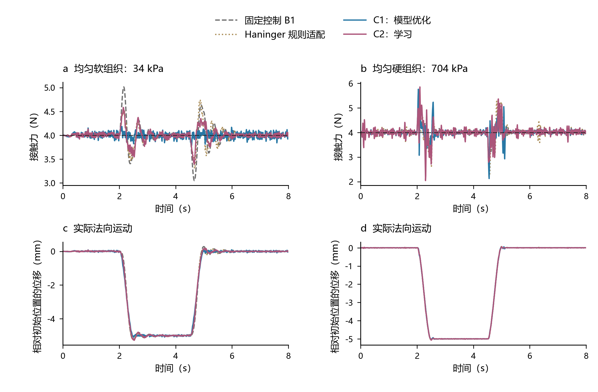

# V. 仿真实验：任务设置与最终结果

围绕“利用新接触信息及时更新阻抗、改善接触控制”的问题，设置刚度变化、独立表面运动和组合扫描三类任务。任务结构参照 Xue 的撤离／推压、Song 与 Li 的刚度／表面变化实验；各任务的作用见下表，原文映射保留于附录 A。本节使用新完成的独立场景，不混用旧版本结果。

## A. 实验设置与任务目的

采用位置控制机器人模型 PC125：外环周期 8 ms，传输延迟 8 ms，位置伺服时间常数 19 ms；力测量 1 kHz、低通 30 Hz、噪声标准差 0.08 N。目标接触力 4 N，积分步长 0.5 ms。接触包含有限足迹、变模量、黏弹性和摩擦；这些是合成工程模型参数。

| 任务 | 设置 | 目的 |
| --- | --- | --- |
| T1：独立刚度变化 | 扫描 8 s；软组织 10–40 kPa、软硬模量比 30；关闭呼吸与推拉 | 隔离材料变化，检验环境变化后的控制调节 |
| T2：独立表面推拉 | 均匀软组织 10–40 kPa／硬组织 0.5–1.5 MPa；关闭呼吸；2 s 开始 ±5 mm 推拉，0.5 s 过渡、保持 2 s 后返回；共 8 s | 隔离表面运动，检验接触保持、冲击及恢复；软／硬×推／拉四格各 10 场景 |
| T3：组合扫描 | 扫描 10 s；骨样软硬区域模量比 10–30，呼吸幅值 1 mm，随机推拉 3–8 mm、过渡 0.5 s | 检验空间异质性与组织运动同时存在时的综合表现 |

测试种子 7200，每任务 40 个相同场景及噪声实现，协议先冻结、随后运行。控制器沿用 train 1000／dev 2000 选定的参数和权重：T1 使用原 T1 配置，T2／T3 使用原 T3 配置。T1 去呼吸及 T2 为冻结参数的结构隔离／迁移检查，不将它们称为每种新任务重新调参后的算法能力上限。T3 保持原训练任务分布，提供新的主比较。神经方法各 3 个训练种子，先在场景内平均，独立场景数仍为 40。

对照沿用已修正适配和扩展调参后的版本，包括 Xue 刚度／投影修正、Jin 单步动作可见端点修正、学习式对照的参考输出和训练校准。Haninger 只适配其阻尼规则；学习式 VIC 是 E27 启发的 ES 训练对照。当前 C1 是估计＋直接优化＋参考补偿＋监督层，C2 是历史信息／锁相估计驱动的蒸馏网络；二者不冒称完整 B0 实现。

指标使用去掉前 1 s 后、8 ms 日志中的真实接触力。报告力 RMSE、峰值、零力时长；峰值是采样峰值。T2 恢复时间从每段运动斜坡结束计算：首次进入 3.5–4.5 N 并保持 25 个连续采样。每段观察 2 s，未恢复者保留并按 2 s 右删失；“截断平均恢复时间”包含这些事件，不是只对成功事件求均值。

## B. 全方法主结果

**表 1：力 RMSE，单位 N，场景均值 ± 场景标准差。**

| 方法 | T1：刚度变化 | T2：均匀组织推拉 | T3：组合扫描 |
| --- | --- | --- | --- |
| 调优固定控制 B1 | 0.1393 ± 0.1901 | 2.3733 ± 4.3798 | 0.3079 ± 0.2194 |
| 估计＋规则 EtR-A | 0.1070 ± 0.0598 | 0.3491 ± 0.2454 | 0.2298 ± 0.0877 |
| Haninger 阻尼规则适配 | 0.1215 ± 0.0605 | 0.3054 ± 0.1531 | 0.2733 ± 0.0838 |
| RLS＋规则 | 0.2005 ± 0.1012 | 0.6424 ± 0.5524 | 0.5228 ± 0.3278 |
| Duan 适配 | 0.5084 ± 0.4135 | 3.1933 ± 2.7928 | 1.0252 ± 0.4717 |
| Song 适配 | 0.1834 ± 0.1087 | 1.6613 ± 2.1159 | 0.4182 ± 0.1996 |
| Jin 单步 | 0.1079 ± 0.0734 | 1.5131 ± 2.3438 | 0.2943 ± 0.1620 |
| Jin 多步 | 0.1167 ± 0.0896 | 0.7666 ± 1.0024 | 0.2852 ± 0.1202 |
| Xue：初始表面先验 | 0.2750 ± 0.1591 | 2.5162 ± 2.6649 | 0.5809 ± 0.5013 |
| Xue：名义表面 | 0.2764 ± 0.1653 | 1.8984 ± 2.4008 | 0.5113 ± 0.3201 |
| 学习式 VIC（ES） | 0.1131 ± 0.0954 | 3.1603 ± 5.8550 | 0.2692 ± 0.2616 |
| C1 v2：模型优化 | 0.0599 ± 0.0255 | 0.7144 ± 1.3446 | 0.1471 ± 0.0644 |
| C2：学习 | 0.0829 ± 0.0317 | 0.3177 ± 0.2379 | 0.2096 ± 0.0964 |

主比较 2,040 次运行和关键消融 1,040 次运行均未出现积分失败。C1／C2 在 T1 与 T3 的平均力 RMSE 均低于全部对照；在 T2 则不是最优，Haninger 规则适配的平均 RMSE 最低。有限均值排名不等于所有场景或全部物理指标占优。

**表 2：T2 的动态与接触表现。峰值为场景峰值的平均，零力时长为单次完整评估的平均；恢复指标合并去程与返回，保留删失。**

| 方法 | 平均峰值／N | 零力时长／s | 2 s 内恢复率／% | 截断平均恢复时间／s |
| --- | --- | --- | --- | --- |
| 调优固定控制 B1 | 16.447 | 1.0020 | 72.50 | 0.633 |
| 估计＋规则 EtR-A | 5.819 | 0.0036 | 100.00 | 0.055 |
| Haninger 阻尼规则适配 | 5.576 | 0.0000 | 100.00 | 0.072 |
| Jin 多步 | 6.220 | 0.1084 | 75.00 | 0.589 |
| C1 v2：模型优化 | 6.967 | 0.2716 | 90.00 | 0.250 |
| C2：学习 | 5.632 | 0.0070 | 99.58 | 0.065 |

T2 的材料分层说明了失败条件：C1 在均匀软组织上的 RMSE 为 0.0572 N，在硬组织上增至 1.3717 N；Haninger 适配分别为 0.1778／0.4330 N，C2 为 0.1428／0.4926 N。因此 C1 的综合优势没有延伸到持续硬接触推拉，不能只展示软组织结果。这组结果评价冻结配置的迁移，不证明所有方法在独立重新调参后的排名。

平均峰值也不能替代最坏事件：T2 的 C1／C2 最坏采样峰值为 22.228／12.116 N，Haninger 适配为 8.668 N；T3 对应为 7.012／13.067／6.926 N。C2 的极值覆盖三个模型共 120 次运行，传统方法为 40 次，不能当成等样本数的极值统计检验。这些实测超力现象必须保留；“未出现积分失败”仅说明数值有限，不代表跟踪成功或安全。

## C. 实际运动响应

图 1 展示 T2 的首个软／硬组织推压场景（编号 0／2；神经模型 0），同时给出接触力与实际法向位移。选择由材料类别和场景顺序确定，不按误差挑选。四条代表曲线用于解释响应，全部 13 种方法仍在表 1 与逐场景数据中。无平滑、无轨迹截除、无超范围隐藏。

法向速度由 8 ms 实际位置差分获得。T3 中 C1／C2／B1 的平均速度 RMS 分别为 5.818／5.880／5.919 mm/s，数值接近，不能据此宣称显著的运动平顺性优势；T2 对应为 6.805／4.738／13.333 mm/s。速度 RMS 本身同时包含必要跟随与不必要运动，不作为“越小越好”的单独排序指标。当前横向通道由共同位置伺服独立控制，因此现有模型不能证明横向轨迹跟踪改善。

## D. 最终方法的机制消融

以下在相同新场景上对最终冻结实现做运行时干预，不重新训练或调参；它们检验该实现的依赖关系，不代表每种删减结构的充分优化性能。其中 C2 的力特征遮蔽会改变训练输入分布，故不把其大幅退化当作重新训练的无力信息方法性能。

**表 3：关键消融的力 RMSE，单位 N。**

| 配置 | T1 | T3 |
| --- | --- | --- |
| C1 完整 | 0.0599 | 0.1471 |
| C1 去表面运动估计 | 0.8970 | 1.5021 |
| C1 只调增益 | 0.1016 | 0.4888 |
| C1 刚度信息延迟 100 ms | 0.0910 | 0.1548 |
| C1 每 40 ms 更新 | 0.0966 | 0.2875 |
| C2 完整 | 0.0829 | 0.2096 |
| C2 只调增益 | 0.0859 | 0.2173 |
| C2 每 96 ms 决策 | 0.1303 | 0.2871 |

C1 在 T3 中只调增益时从 0.1471 N 增至 0.4888 N，说明参考补偿对完整方法的优势具有关键作用。因此不能把全部收益归因于快速更新刚度／阻尼。去表面运动估计在无表面运动的 T1 中也明显退化，意味着该状态还可能补偿接触／执行模型误差，不能把这一消融解释成已准确辨识真实表面运动。放慢 C1／C2 决策均使误差上升；额外 100 ms 刚度信息延迟的影响则在 T1 明显、T3 较小。

## E. 在线更新时间与局部数值质量

计时在同一机器、单个仿真进程、预热后进行，每任务每模型 3 个完整场景；从观测对象组装至估计、决策和输出限幅。不包含仿真动力学积分，也不伪称已测量实物传感器通信与机器人发布。神经方法合并三个模型的原始调用时间后计算分位数。

**表 4：在线更新时间 P99，单位 ms。**

| 方法 | T1 | T3 |
| --- | --- | --- |
| 估计＋规则 EtR-A | 0.0701 | 0.0626 |
| Haninger 阻尼规则适配 | 0.0621 | 0.0660 |
| Jin 单步 | 0.0720 | 0.0732 |
| Jin 多步 | 0.3041 | 0.2931 |
| Xue：初始表面先验 | 0.2172 | 0.2241 |
| 学习式 VIC（ES） | 0.0136 | 0.0098 |
| C1 v2：模型优化 | 0.1523 | 0.1379 |
| C2：学习 | 0.0272 | 0.0376 |

全部 101,262 次已记录软件更新中，超过 8 ms 的次数为 0。固定控制和 Duan 为预计算增益，只有初始化接口计时，不将三个初始化样本与逐周期更新混作等样本统计。当前所有在线对照均明显快于控制周期，C2 快于 C1，但模型优化耗时尚未构成该任务的主要瓶颈。

最终 C1 在两任务各取前 6 个场景，以固定间隔抽取 234 个实际优化快照。保持同一状态、估计、目标、约束和动作类，从当前解、前次解及规则先验三个初值，分别运行 25／50／100 次 GN，取较低代价作为数值参考。参考在 50→100 次迭代时的最大相对代价变化低于 3×10⁻⁸%，表明该比较中的数值代价已经稳定；这不是全局最优证明。

| 任务 | 快照数 | 平均代价差／% | 中位数／% | P95／% | 最大／% |
| --- | --- | --- | --- | --- | --- |
| T1_static | 102 | 0.720 | 0.017 | 1.490 | 34.946 |
| T3_combined | 132 | 2.480 | 0.050 | 1.095 | 198.960 |

大多数快照接近这一局部参考，但个别差值显著，不能声称每次更新都保证近优。代价差包含该 OCP 已定义的正则项，不冒称物理误差百分比。C2 没有相同动作类与目标下的最优性保证，本次不以力 RMSE 排名替代该保证。

## F. 统计与结论

场景是统计单位。全部 66 个“候选－对照－任务”的 RMSE 差异使用场景配对 bootstrap（100,000 次），并以 Bonferroni 调整得到约 95% 家族覆盖的区间；它们是条件于已有训练模型的区间，不额外推断训练算法的总体分布。完整区间见 completed_tasks/paired.csv，不能把均值排名自动称为每项差异均有统计证据。

调整后的区间中，C1 在 T1／T3 相对全部 11 个对照的 RMSE 差均低于零；C2 在 T1 也如此，但 T3 相对 EtR-A 和学习式 VIC 的区间跨零。因此 C2 的 T3 均值领先尚不足以支持其对全部对照的差异均成立。

1. **控制效果：**C1／C2 在独立刚度变化和原分布组合扫描中降低平均力误差；均匀硬组织推拉存在明确反例，故不支持所有任务／指标全面领先。
2. **收益来源：**当前 C1 的优势来自估计、参考补偿与及时更新的共同作用，证据不足以单独归因于阻抗更新算法。
3. **计算与近优：**软件更新均满足本机测得的 8 ms 预算；现有平台下尚无主要优化计算瓶颈，且局部参考存在显著个别差值，不支持统一的近优保证。
4. **证据范围：**本轮完成三类任务、全对照、关键机制、实际法向运动和软件时效比较。未增加跨平台／能耗／成像指标；这些不构成本轮接触控制仿真的必做清单。真实机器人应用与完整 B0 认证仍不由本仿真替代。

## 附录 A：逐篇“研究问题—实验任务—评价指标”核读映射

下列核读记录是本次选择指标的原始依据。正文仅保留与自身主张相匹配的指标；不把 12 篇所有指标的并集当作投稿清单。

**Xue，RAS 2025**（[原文实验段](../literature/extracted_text/xue.txt#L475)；核读段落行号 [(1, 45), (475, 630)]）

- 研究问题：未知软环境和突发推拉下兼顾接触保持、柔顺性与约束。
- 实验任务：非均匀硅胶的撤离／推压、位置约束和手臂交互。
- 原文评价：分扰动阶段的力 RMSE、最大绝对误差、推压后的力增量、每步计算时间；位置／力／阻抗曲线。
- 本研究如何使用：迁移分阶段接触与冲击指标、更新计时；不据力误差声称成像效果。

**Jin，TMECH 2023**（[原文实验段](../literature/extracted_text/field_papers/E41.txt#L629)；核读段落行号 [(1, 45), (629, 814)]）

- 研究问题：在线调整运动精度与柔顺性的权衡，同时处理约束。
- 实验任务：轨迹遇障、状态约束、不同速度的自由空间轨迹／插入。
- 原文评价：最大／RMS 位置误差与最大／RMS 接触力，速度和增益轨迹。
- 本研究如何使用：力与运动必须分开验证；只有存在独立运动目标和可受方法影响的运动通道，位置误差才有比较意义。

**Song，RA-L 2025**（[原文实验段](../literature/extracted_text/field_papers/E04.txt#L382)；核读段落行号 [(1, 38), (382, 477)]）

- 研究问题：环境位置和刚度未知时实现鲁棒力跟踪。
- 实验任务：刚度突变平面、斜面、正弦面；仿真与实际接触。
- 原文评价：力误差、超调和调节时间，位置／力响应曲线。
- 本研究如何使用：补环境变化后的恢复时间，不能只用整段平均误差掩盖短时迟滞。

**Duan，RAS 2018**（[原文实验段](../literature/extracted_text/field_supplements/F02.txt#L416)；核读段落行号 [(1, 44), (416, 527)]）

- 研究问题：未知环境和变化期望力下的自适应接触力跟踪。
- 实验任务：平面刚度变化、斜面、正弦／复合面、动态期望力。
- 原文评价：位置与力的时域响应、稳态偏差和适应过渡；不虚构原文不存在的统一统计总表。
- 本研究如何使用：采用能区分刚度变化与表面运动的任务；位置曲线不等于位置跟踪误差。

**Li，T-RO 2025（E27）**（[原文实验段](../literature/extracted_text/field_papers/E27.txt#L784)；核读段落行号 [(1, 38), (578, 718), (784, 874)]）

- 研究问题：通过仿真阻抗学习提高未知地形上的力跟踪与泛化。
- 实验任务：平面／斜面／复杂面、训练迭代、未见地形及加工／剥皮／人机任务。
- 原文评价：力误差、调节时间、最大超调与振荡；训练阶段误差；应用任务另报剥皮厚度或人用力。
- 本研究如何使用：训练曲线和未见环境对学习路线有意义；剥皮／人用力不适用于当前扫描模型。

**Haninger，RAS 2023**（[原文实验段](../literature/extracted_text/haninger.txt#L643)；核读段落行号 [(1, 44), (643, 748)]）

- 研究问题：用未知接触模型和任务代价调节交互阻抗。
- 实验任务：未知刚度接触、导轨装配、人工引导抛光与振动扰动。
- 原文评价：高／低频实际速度 RMS（表 3 以 15 Hz 分带）、计算规模；同时检查任务运动。
- 本研究如何使用：接触运动的振荡代价比套用无人机平顺性更直接；频带和激励应统一公开，不能单独按速度越小越好排序。

**Kong，TSMC: Systems 2025（NNBO）**（[原文实验段](../literature/extracted_text/nnbo.txt#L610)；核读段落行号 [(1, 39), (610, 779)]）

- 研究问题：改善软环境模型，并通过最优阻抗关系优化交互性能。
- 实验任务：Franka 与硅胶／海绵交互、HC／KV 模型和不同目标权重。
- 原文评价：力模型 ME／AE／MaxE，位置／力轨迹，收敛代价和累计代价。
- 本研究如何使用：最优控制论文可以报告已定义的任务代价；不能把本项目调参综合分数冒称物理量或最优性证明。

**Matschek，TCST 2023**（[原文实验段](../literature/extracted_text/field_supplements/F04.txt#L578)；核读段落行号 [(1, 43), (578, 655)]）

- 研究问题：模型不确定时同时控制运动和接触力并满足安全约束。
- 实验任务：机器人接触路径、GP 混合模型、输入扰动及实物验证。
- 原文评价：力 RMS 误差、位置输出与约束满足；总计算时间及传感器通信／OCP 分解。
- 本研究如何使用：完整链路计时与约束验证应独立于纯策略调用时间。

**Jin，TMECH 2025**（[原文实验段](../literature/extracted_text/field_supplements/F06.txt#L816)；核读段落行号 [(1, 44), (816, 868)]）

- 研究问题：稳定可变阻抗下保持精度、柔顺性和平顺性。
- 实验任务：机器人抛光、能量罐对比、近似等跟踪精度的控制比较。
- 原文评价：最大／平均控制力、圆轨迹误差、控制力变化平顺性指标。
- 本研究如何使用：评价需对应任务；圆轨迹误差不搬到无圆轨迹目标的扫描任务，也不混淆控制力与接触力。

**YOPO，RA-L 2024**（[原文实验段](../literature/extracted_text/method_transfer/YOPO.txt#L476)；核读段落行号 [(1, 45), (476, 545)]）

- 研究问题：把在线规划负担转移至离线学习，兼顾规划质量与低延迟。
- 实验任务：同目标的优化专家比较、不同障碍密度／速度的森林飞行。
- 原文评价：候选平均／最佳轨迹代价，分模块／总延迟，障碍距离，积分平方 jerk、路径长度和成功率。
- 本研究如何使用：迁移质量—时间联合评价和离线／在线分工；不强行搬入障碍距离和飞行成功率。

**Wang，TASE 2024**（[原文实验段](../literature/extracted_text/field_supplements/F09.txt#L475)；核读段落行号 [(1, 40), (475, 535)]）

- 研究问题：位置控制机器人上的六维柔顺运动和力调节。
- 实验任务：独立自由空间轨迹、外力扰动及超声接触。
- 原文评价：独立轨迹的平均／最大位置误差、相对力误差和各维响应。
- 本研究如何使用：运动评价来自可比较的运动任务，而不是给当前统一横向伺服轨迹补一列无区分度误差。

**AuSoScan，TMECH 2025**（[原文实验段](../literature/extracted_text/field_supplements/F08.txt#L568)；核读段落行号 [(1, 43), (515, 541), (568, 621)]）

- 研究问题：软接触建模、图像感知和脊柱超声自动扫描／重建。
- 实验任务：阶跃／斜坡／波形力与路径跟踪、模体和人体脊柱扫描。
- 原文评价：力／位置跟踪误差，图像定位置信和脊柱重建结果。
- 本研究如何使用：力控制收益与成像／重建质量分层；本项目无声学或图像模型，不能把力合格率当成成像质量。

## 附录 B：复算与原始证据

- 新主结果、消融、恢复时间、计时原始样本及数值参考：[completed_tasks](../experiments/cobot_scan_benchmark/completed_tasks/README.md)。
- 旧任务与适配修正证据：[refined_baselines](../experiments/cobot_scan_benchmark/refined_baselines/results.md)。
- 生成正文：`python -X utf8 experiments/cobot_scan_benchmark/write_completed_report.py`。
