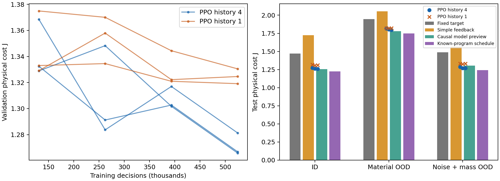

# 候选2：学习生成自适应阻抗的快速评估

本轮由用户授权，比较起点为 `cb8b382`。这是候选验证，不是主线选择；不修改B0正文、问题、证明或长期要求。结论不能由仓库原有叙述直接推出。

## 定位及与B0的关系

候选2的可执行接口为：

\[
h_t=(\text{位姿/速度/力历史、实际增益、能量、任务输入})
\xrightarrow{\pi_\theta}(K_t^{\rm target},D_t^{\rm target})
\xrightarrow{\text{增益率与能量约束执行}}(\dot K_t,\dot D_t)
\xrightarrow{\text{实际增益动态}}\text{阻抗控制}.
\]

实际增益是状态，网络输出的是目标；不能直接跳变替换实际增益而宣称满足B0执行条件。也可以直接学习增益率，本轮未比较这两种参数化。参考运动由外部提供，故“端到端”的范围只是观测到阻抗决策。

B0本已用价值函数在线恢复反馈，不是每个低层周期重解完整HJB。候选2可能减少显式MHE/描述符及模型修订后的Bellman–KKT根维护，但会把负担转移到训练覆盖、隐式状态估计和部署校验。是否全部替代这些模块，还是保留模型估计作为策略输入，应由所需能力决定。本轮并未实现或测量完整B0，不能宣布比方法1快或强。

## 原文核对与理论判断

- [YOPO原文](https://tju-air-lab.github.io/projects/YOPO/YOPO.pdf)，RA-L 2024，DOI [10.1109/LRA.2024.3399589](https://doi.org/10.1109/LRA.2024.3399589)：用轨迹代价数值梯度，经链式法则指导网络训练；不是PPO。网络一次输出多候选的修正及评分，运行时仍滚动规划。可迁移机制包括离线摊销在线求解、结构化候选覆盖和利用训练期额外环境信息；本轮只检验直接策略路线，没有复现完整YOPO机制。
- [VICES原文](https://arxiv.org/html/1906.08880)，IROS 2019，DOI [10.1109/IROS40897.2019.8968201](https://doi.org/10.1109/IROS40897.2019.8968201)：明确采用PPO比较动作空间，已包含末端可变阻抗、接触任务及仿真到实机实验。因此“仿真PPO输出阻抗”本身已被直接覆盖。
- [SRL-VIC原文](https://arxiv.org/html/2406.13744)，RA-L 2024，DOI [10.1109/LRA.2024.3396368](https://doi.org/10.1109/LRA.2024.3396368)：结合SAC任务策略、安全critic和恢复策略，输出位移及刚度，阻尼按给定规则计算。它提供相关安全学习先例，经验风险评估不等于任意时变阻抗的确定性稳定证明。
- [Zanella等原文](https://arxiv.org/html/2301.12759)，IET CTA 2024，DOI [10.1049/cth2.12558](https://doi.org/10.1049/cth2.12558)：已研究RL策略在推理时及训练时结合能量池；采用SAC，讨论能量状态、任务能量及无源性与实际安全的差别。因此也不能把“RL＋能量池”直接算作新贡献。其执行结构与本轮增益率屏障不同，不将其定理直接移用于本轮。
- [Yang等2025论文的出版社摘要](https://www.sciencedirect.com/science/article/abs/pii/S2405896325015903)，DOI [10.1016/j.ifacol.2025.10.191](https://doi.org/10.1016/j.ifacol.2025.10.191)：明确提出RL阻抗动作＋无源参数生成器＋自适应鲁棒执行。这里只核到摘要，尚未审计其完整假设、证明和实验；足以提示该组合有直接先例，不足以判断它已解决本项目全部困难。

这是针对所提机制的原文核对，不是截至当前的完整领域综述。已有先例要求进一步寻找重要能力边界，不意味着必须绕开学习路线。

**能成立的部分。** 对有界动作与有限时域任务，观测历史到阻抗目标是合法策略类；PPO不要求对接触求导。训练可覆盖动作对后续接触的影响，推理不需要在线做策略梯度优化。若模型梯度可靠，YOPO式代价梯度训练、模仿/蒸馏也值得比较，PPO并非由这个思路唯一推出。

**不能直接成立的部分。** PPO有限样本、非凸训练没有全局最优或逐实例最优保证；短历史不保证构成充分状态，观测相同而未来材料不同的情况无法凭网络区分。域随机化只覆盖设定的分布，不保证迁移。用训练时真材料作actor输入会改变问题；本轮actor和critic均不读取它。

正刚度/阻尼不能消除变刚度的注能项 \(\frac12e^2\dot K\)。本轮复用Q2能量状态
\(\dot E=\chi(B_r+D)v^2-\frac12e^2\dot K\)，在实际增益率上实施能量屏障及增益/速率边界。名义连续模型中可得到 \(\dot E\ge-\alpha(E-E_{\min})\)；机械储能加能量池的导数为 \(vF_{\rm error}-(1-\chi)(B_r+D)v^2\)。这只是该载体的输入输出耗散关系和条件性不变性，不是全机器人跟踪稳定性、力安全或离散实现认证。力/执行力约束在本轮仅处罚并检查，未由能量投影一并保证。

## 快速实验：固定协议与边界

复用 `动态接触强对照/Q2` 的实际 \((e,v,K,D,E)\) 动力学、代价及连续执行投影。没有人为指定“正确阻抗轨迹”。这是保持接触的一维线性弹性载体，未包含B0柱面有限足迹、完整wrench/MHE、摩擦、四增益或全机器人。

- 每回合4秒，策略8Hz；积分200Hz，RK各阶段执行共同约束。目标范围K为20–1200 N/m，D为1–30 N·s/m，增益率界400、30。初始实际增益50、3。
- 随机材料初值200–400、变化幅度100–400 N/m；机器人阻尼0.8–1.2。两次表面运动的时间、宽度和幅值随机化。测量噪声标准差为位置10 μm、速度0.1 mm/s、力5 mN。完整生成器见 `cases()`。
- 噪声施加于策略/材料估计观测；共同低层投影仍使用仿真真状态和实际机器人阻尼。它是理想的名义保护层，不能把这里的噪声测试解释为带噪执行保护或真实硬件安全验证。
- **两次未来表面运动程序为各方法共同已知的外生任务输入**，不是从未知组织中感知得到的未来信息。材料真值/未来轨迹不进入策略；初始无激励时不同材料的观测确实相同。
- PPO采用Stable-Baselines3，双64单元Tanh网络，64并行环境，3个种子，每种子524,288次决策；另做单帧版本的3种子消融。总计3,145,728次决策，98,304回合。增益目标对数映射，执行共同投影。没有专家示范或测试集调参。
- 对照：调优的固定目标阻抗；5参数状态/力反馈；同观测历史的岭回归材料估计＋近似平衡代价/已知运动预览；固定材料先验＋已知运动程序的调优调度。最后一个对照在读取保留测试集前加入，避免把任务时序收益当成观测适应收益。
- 简单对照在64个训练分布实例上DE/Powell调优；64个独立验证实例选择参数。PPO每131,072步作验证，仅保留验证代价最好的checkpoint。训练每步另加负约束裕度的10倍处罚，选择时另加整回合负最小裕度的100倍处罚；最终表格单报原物理代价J和违规，不能混用奖励。
- 保留测试：同分布、材料范围外推（初值450–600、变化幅度450–650）、质量/噪声偏移（质量0.24–0.28 kg、噪声3倍），各96个配对实例；各策略使用相同任务及测量噪声流。最终集只在方法与checkpoint冻结后读取，没有因结果不利续训或调整任务。

## 数值结果

每类96个未参与训练/选参的配对实例；下表为平均物理代价J（越低越好），PPO列出三个种子的范围，未挑最好种子。

| 方法 | 同分布 | 材料外推 | 质量/噪声偏移 |
|---|---:|---:|---:|
| 调优固定目标 | 1.4701 | 1.9449 | 1.4869 |
| 所调状态/力反馈族 | 1.7237 | 2.0538 | 1.5646 |
| 因果材料估计＋预览 | 1.2545 | 1.7802 | 1.3060 |
| 固定先验＋已知程序调度 | 1.2257 | 1.7494 | 1.2427 |
| PPO，四帧历史 | 1.2607–1.2745 | 1.7978–1.8168 | 1.2681–1.2869 |
| PPO，单帧 | 1.3075–1.3179 | 1.8199–1.8227 | 1.3268–1.3319 |

四帧PPO相对调优固定目标的逐实例配对平均代价改善：同分布13.27%–14.34%，材料外推6.52%–7.63%，质量/噪声偏移13.49%–14.87%。但相对固定先验的已知程序调度，代价分别**高3.06%–4.36%、2.85%–4.08%、2.19%–3.85%**。相对因果估计预览，PPO在前两组略差，在质量/噪声偏移组略好；不能只选有利组。

同分布四帧PPO的平均接触力峰值3.701–3.723 N，调度为3.609 N、固定目标为3.486 N；力误差RMS分别约0.172–0.178、0.153、0.127 N。PPO位置误差较小，但接触力较大，综合代价改善不是各项指标同时改善，也不是安全优势。原始其余分项见 `test.json`。

全部已测策略/实例在数值容差1e-7内通过所检查裕度。这不是独立定义的任务成功率，不能证明PPO学会了约束或提供硬件安全保证；约束在这些测试中没有区分方法。四帧PPO约8.71%–11.85%的积分步起点发生共同执行投影干预，实际策略必须包含该执行层。

四帧版本在当前预算中比单帧版本好，但它们输入维数不同，尚无收敛充分性的证据；这不是“历史已经完成材料辨识”或历史机制的严格因果证据。固定先验调度胜出进一步表明，本载体并未建立“必须利用隐含材料信息才能取得好性能”的需求。因果估计预览较差只评价该估计器/近似预览组合，不等于更新信息本身没有价值。

六次PPO各约49.5–53.9秒，总约308.6秒（不含安装、首次JIT及全部评估）；该线性载体高度加速，不能套用到全机器人接触仿真。四帧模型单例Python推理中位数约0.098–0.100毫秒，固定和状态反馈约0.011、0.028毫秒，未编译的Python预览约3–6毫秒。这里只测策略调用，不含完整低层执行、感知、通信；基线实现也未统一优化，不支持普遍加速或实时认证。

核验：保持策略8Hz而把积分步缩小4倍，10种控制器各12个材料外推实例的最大相对J变化为0.01386%；另以独立写出的动力学/代价/投影方程和DOP853核对6种控制器各3个材料外推实例，最大相对J差0.002997%。两种不同材料在初始静止接触时产生完全相同的策略观测，数值核对差为0。积分检查支持本轮数值比较，不能补齐被省略的B0结构。



## 当前判断和后续价值

**可以保留候选2：实现可行，能学到优于固定目标的策略；当前没有显示超过较强简单调度的性能收益，也未确立论文贡献。** 不能称为生成最优阻抗，不能宣称取代B0后更快/更优，也不能因为这一简化载体中无优势就否定学习控制在真实接触问题中的价值。贡献依据应是重要问题上的可靠收益，不要求PPO具有独占能力。

下一步优先结合原任务和强prior的实际能力，确定仍有价值的重要困难，再决定该路线承担什么能力。复杂接触、部分观测、模型误差、效率与安全权衡等都只是待核对方向，不是选定题目或固定验收门槛。若领域证据支持其中某一问题，再选择保留相应困难的任务，比较调优解析/模型方法与学习方法，并判断是否需要PPO、模型梯度、蒸馏或组合；避免为证明网络有效而不断改任务、加预算或缩小问题。


## 复现

建立独立Python环境。CPU PyTorch先用官方CPU源安装 `torch==2.7.1+cpu`，再安装本目录 `requirements.txt`；不要将其覆盖到其他实验环境。依次运行：

```bash
python 实验/候选2_学习阻抗/run.py calibrate
python 实验/候选2_学习阻抗/run.py train
python 实验/候选2_学习阻抗/run.py test
python 实验/候选2_学习阻抗/verify.py
python 实验/候选2_学习阻抗/plot.py
```

首轮先运行前三类对照，随后以 `calibrate --only prior_preview` 加入调度对照；完整重跑的 `calibrate` 会依次生成四类，算法/种子相同。JIT首次编译及并发任务影响墙钟计时，不能把原型计时称作实时认证。单例推理计时包含Python调用开销，未对各简单对照统一编译优化；不据此声称学习方法必然更快。

`results/` 中保留六个模型、固定协议、调优参数、学习曲线、测试逐实例指标、独立积分核对和图。随机数种子与生成器可重建任务，不额外保留大量重复轨迹。
