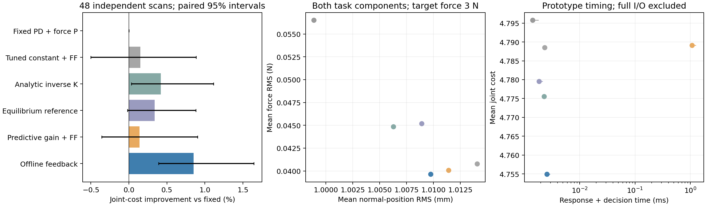

# 同次扫描中的阻抗反馈：方法设计、迭代与快速验证

2026-10-18。**当前两个具体原型均未建立稳定且有实质分量的任务优势，未达顶刊贡献标准。** 已完成模型路线、直接任务损失离线训练、仅学习K/D的后续迭代，以及修正运动耦合模型后的冻结策略测试；全部结果保留。原问题保持。本目录保留可复用的估计、执行、简单对照、离线公式及物理修正；不是完整候选1或候选2，不能据本组结果限定未来贡献形式。

## 实际实现了什么

**模型路线。** 从有噪声、延迟的力/力矩与运动历史拟合局部响应：法向斜率、空间变化率和剩余时间漂移。力矩扣除已知摩擦力臂后，以局部仿射压力近似得到空间梯度；不是完整材料场恢复或无误差预瞄。用约0.192秒预测、25个候选比较实际K/D目标与可选法向前馈修正，经过速率/能量执行再评价任务损失。预测为单个名义模型，未实现原设计的多响应不确定性集合、完整RTI发布校正、HJB/NNBO/NEOC。

**离线路线。** 直接以整段扫描的真实仿真任务损失训练小型结构化反馈，用成熟交叉熵策略搜索，避免模仿不唯一的“最优K/D标签”。联合版有8个系数，核心形式为

\[
\log K_n=a_0+a_1\log(\widehat k/1000)
+a_2\tanh((\widehat F_n-F_d)/0.3)+a_7\tanh(v_n/0.01),
\qquad \log D_n=a_3+a_4\log(\widehat k/1000).
\]

公式中的K/D使用本实验物理单位的数值，特征按所示标度归一化。其余系数控制空间/时间预测的前馈混合。后续纯增益版将额外法向前馈固定为零，只训练6个增益反馈系数。**策略输出法向K/D目标，实际增益经过共同执行动态；切向K/D固定，非四增益神经策略或PPO复现。** 同样保留共同目标力前馈和切向力补偿；“纯增益”仅指不新增法向前馈动作。

这些是成熟预测控制、解析二次优化和策略搜索的复用/组合，不将工具名称或组合本身当创新。学习中的状态依赖也不是新发现B0漏了状态；B0本来就定义了状态反馈。

## 任务与公平条件

有限宽度柱面探头/弹性地基＋局部法向速度阻尼，切/法向机械动力学、四实际增益、幅值/速率和能量账本、执行器限幅。不是B0异质Hertz模型或全机器人。接触/执行公式与既有扫描地基、接触约束实验同类，本轮重新实现未知持续扫描及信息时序，未复用旧性能数据。

- 接触半宽10mm、横向长度20mm、曲率半径50mm；扫描64mm，速度8/12/16mm/s，目标3N。地基系数1.5–9MN/m³，空间对比与表面起伏随机；运动组有0.15–0.35Hz运动。局部阻尼系数按2–15ms的时间比例设置，**不是带长时松弛内部状态的组织模型**。范围为探索条件，未按真实平台联合标定。
- 100Hz有噪观测，20ms传感延迟；25Hz目标增益更新，实际增益与机械状态以1ms积分。模型优化、解析法与策略共享位姿、力/力矩、增益和历史，无材料/未来真值。强初始化只用已声明初始表面参考、3N及测得位姿；常数1000N/m先验作为同方法敏感性检查。
- 起点已有3N接触并已建立扫描速度；没有验证接触建立成本、免除患者特异准备或真正零标定。理想两轴动力学补偿、固定姿态、无重力补偿误差/测量偏置，不能当真实超声机器人性能。
- 主任务为力、切/法向位置、法向速度和执行力代价；位置尺度1.5mm、力尺度0.3N。法向参考为初始位置，不读取组织未来运动。它是B0式联合目标的一个实例，**不是临床认可的唯一目标**；相对患者保持位置时需要相应参考更新。另保留法向自由随动任务，不将两者混成同一实验。

直接力反馈、合理参考补偿、解析方法和普通离线调优均可作为强对照。局部静态线性接触、忽略控制代价/粘性/积分作用时，二次目标给出熟知关系
\(K_n=(1+k_p)Q_z/(Q_F\widehat k)\)。这里只用作充分简单参照，不称本轮新定理或完整任务精确最优。

## 第一批：48个未见场景

18训练/18验证；固定参数覆盖128组，再连续调优简单策略、解析策略及参考控制。条件策略先搜索280次，再在更充分共同初始化下搜索140次。**锁定配置/协议后**生成48场景（每族16），对16种实现及两类初始化配对比较。各方法在验证状态实测必要响应更新＋决策时间，重放各自p95发布延迟；不包含I/O/操作系统全部开销，不是WCET或机器人实时认证。

下表为共同强初始化、计入上述延迟的主任务结果。J越小越好，RMS为逐场景均值，峰值为整批最大值。

| 方法 | 平均J | 力RMS/N | 法向位置RMS/mm | 最大力/N |
|---|---:|---:|---:|---:|
| 固定增益＋力反馈 | 4.79579 | 0.05652 | 0.99889 | 3.3077 |
| 连续调优固定增益＋前馈 | 4.78854 | 0.04077 | 1.01406 | 3.2402 |
| 解析刚度律＋调优阻尼/前馈 | 4.77558 | 0.04487 | 1.00628 | 3.4018 |
| 局部平衡参考补偿 | 4.77958 | 0.04521 | 1.00891 | 3.3651 |
| 模型预测：增益＋前馈 | 4.78911 | 0.04007 | 1.01140 | 3.4332 |
| 离线反馈：增益＋前馈 | 4.75491 | 0.03965 | 1.00975 | 3.2229 |

- 模型联合优化相对充分解析规则平均J差约**+0.283%**，配对区间跨零，未显示优势；其力RMS较低，但位置误差和峰值更差，不能只报力指标。
- 联合离线反馈相对解析规则平均J低**0.433%**，按场景配对bootstrap 95%区间约**[0.261%,0.630%]**。力RMS从0.04487降到0.03965N，法向位置RMS从1.00628升到1.00975mm。是小而可核查的正结果，不等于新增重要任务能力。
- 学习相对解析规则在均匀/静止、异质/静止、异质/运动三组的平均J改善约1.179%、0.709%、0.258%；最后一组区间跨零。不能用总平均宣称对所有环境变化可靠。
- 模型联合优化的中位响应＋决策时间约1.067ms，解析规则约0.00229ms，联合离线反馈约0.00256ms。学习快于在线rollout，却未快于简单解析控制；不把这种计时比较直接当计算贡献。



## 后续迭代：仅学习K/D，另一批24场景

第一批不能把联合输出收益归因于增益学习。因此在原训练/验证集重新训练**不新增法向前馈**的增益策略，并连续调优同动作族的常数K/D和解析规则；再锁定协议，生成另一批24场景。没有将旧48例包装成该新方法的独立测试。

| 方法 | 平均J | 力RMS/N | 法向位置RMS/mm |
|---|---:|---:|---:|
| 连续调优固定K/D | 4.64838 | 0.04084 | 0.99456 |
| 解析K律、调优D | 4.78014 | 0.04933 | 0.99187 |
| 离线学习K/D | 4.67991 | 0.04154 | 0.98930 |
| 原联合策略，不重训 | 4.64917 | 0.03807 | 0.99258 |

纯增益学习相对连续调优固定增益平均J**高0.678%**；以“改善”为正的配对区间为[-3.473%,0.376%]。14/24例改善，但最大单例代价恶化约0.958，不能只数胜例。原联合策略在此批相对固定增益也无可靠优势，平均J几乎相同。主批对解析规则的小优势仍是原结果，但尚未跨充分简单参照和新样本稳定保持。

将新增固定参照回查旧48例，只列为**事后补强对照**：联合策略均值低约0.693%，区间跨零，不增加“独立测试”计数。详细配对结果见`followup_analysis.json`。新批的代价差来自力和位姿取舍，不能凭某一RMS均值解释全部J。

## 数值核查与证据边界

1. 独立写压力积分、执行器与代价，用DOP853重新产生观测并运行因果控制；两例×四反馈的J相对差最大约2.21e−5，不是只重放旧动作。
2. 主批全部48例对解析、联合学习和模型优化做四倍时间细化及33→129压力节点细化。联合学习相对解析的改善仍约0.433%，区间约[0.256%,0.627%]。说明主批小正结果不是当前积分分辨率造成。
3. 初轮30个压力/大切向误差/低能量构造状态中，1ms积分和33节点存在较大差异，原始检查保留。正常任务核查不覆盖那些边界，也不认证安全。纯增益新批另核最大回退例及两个指定例的细化。
4. 主批未出现接触丢失、执行器饱和，能量过滤未激活；不支持困难约束下的优势。单一理想接触模型内留出不是跨物理模型/实物泛化。区间条件于当前训练结果，不含训练随机性。
5. 未完成完整B0或Xue、Li、Haninger等原文控制器的同任务复现；本轮参照为明确的原理性实现。未训练原PPO，未证明NEOC优于Newton，也未证明生成真实最优阻抗。

### 物理核查：数值一致不等于接触模型可信

进一步核查发现，本载体的速度阻尼是**简化局部项，不能等同完整移动Kelvin接触**。固定材料点X的压入量导数应含\(\dot z+(X-s)\dot s/R-h_t\)，当前阻尼只保留\(\dot z-h_t\)，没有建立对应的完整切向变形力/足迹边界功率关系。此遗漏会影响对力矩中材料信息的解释；控制性能不能直接外推到真实空间预瞄。

`contact_kinematics_audit.py`在均匀介质、恒速、3N的局部截面例中，补上对流项后法向力不变，但法向一阶矩约0.000192Nm；直接用3M/A²映射会得到5.76N/m的表观梯度。完整漂移观察器可能吸收其中一部分，**该例不证明整个控制器必然误差或方法失效**，也不是完整有限探头物理验证。AuSoScan等已有速度相关压力机制，不能把它当新发现。

### 补充实现：运动耦合修正，另24个新场景

没有停在指出缺项：单独实现`coupled_contact.py`，保留原模型/结果以便追溯。法向压力包含材料点对流应变率，切向弹性力由离散地基势能对扫描位置求导，包含有限窗口项；粘性切向力与同一应变率配对。压力截断、摩擦和运动组织的功率一并计算。48个随机状态的离散环境功率恒等式残差最大约2.17e−11W、耗散非负；这是模型内部检查，**不是完整六维探头、真实组织或闭环安全证明**。力矩通道仍为理想化压力矩/力臂关系。

冻结原参数，不用新测试调优，锁定协议后另生成24场景（种子8601/8602），以0.5ms、129节点运行7种原控制器：

| 方法 | 平均J | 力RMS/N | 法向位置RMS/mm |
|---|---:|---:|---:|
| 连续调优固定K/D | 5.01345 | 0.04290 | 1.02610 |
| 解析K律＋调优D/前馈 | 4.96935 | 0.04728 | 1.01578 |
| 模型预测：增益＋前馈 | 4.99662 | 0.04394 | 1.01887 |
| 离线反馈：增益＋前馈 | 4.95937 | 0.04928 | 1.00389 |
| 离线学习K/D | 5.00494 | 0.05483 | 0.99686 |

联合学习对固定均值改善1.079%（配对区间[0.195%,1.919%]），但对充分解析规则仅改善0.201%（[-0.278%,0.806%]）；纯增益对固定改善0.170%（[-0.368%,0.991%]），模型联合优化对解析反而差0.549%。**修正物理后仍未建立相对充分简单控制的稳定优势。** 这批检验冻结控制器的模型敏感性，不是各方法在新模型上重新充分调优后的排名；未把三批混成统一96例测试，也未复现全部原文强控制器。重放旧原型计时，不作为新模型实时性测量。

原指定两例与纯增益最大回退例共三例×三策略，将时间/空间网格再细化为0.25ms/257节点，J相对变化最大约3.86e−5。仅支持这些数值检查，不补足真实组织标定。


## 保留用途与定位纠正

局部响应估计、实际增益执行、解析/固定/参考控制、任务损失搜索与修正接触模型可用于后续基线或载体。CEM小型反馈公式是探索变体，尚未证明它比“完整环境估计/空间预瞄＋离线NN”的候选2更好；不得继续以候选2名称报告其表现。旧模型的缺项和全部正负结果保留在上文；新研究不得把旧简化模型当已验证真实接触。后续任务由当前用户要求及HANDOFF确定。

## 复现与版本

本目录`requirements.txt`和`environment.json`保存已测环境（不同于旧根目录部分版本）。当前结果可依次重建：

```bash
OPENBLAS_NUM_THREADS=1 python 实验/同次扫描阻抗反馈/iterate.py --task force
OPENBLAS_NUM_THREADS=1 python 实验/同次扫描阻抗反馈/iterate.py --task joint
OPENBLAS_NUM_THREADS=1 python 实验/同次扫描阻抗反馈/learn_policy.py
OPENBLAS_NUM_THREADS=1 python 实验/同次扫描阻抗反馈/finalize_policy.py
OPENBLAS_NUM_THREADS=1 python 实验/同次扫描阻抗反馈/tune_reference.py
OPENBLAS_NUM_THREADS=1 python 实验/同次扫描阻抗反馈/evaluate.py
OPENBLAS_NUM_THREADS=1 python 实验/同次扫描阻抗反馈/pure_gain.py
OPENBLAS_NUM_THREADS=1 python 实验/同次扫描阻抗反馈/audit_closed_loop.py
OPENBLAS_NUM_THREADS=1 python 实验/同次扫描阻抗反馈/refine_test.py
OPENBLAS_NUM_THREADS=1 python 实验/同次扫描阻抗反馈/audit_followup.py
OPENBLAS_NUM_THREADS=1 python 实验/同次扫描阻抗反馈/followup_analysis.py
OPENBLAS_NUM_THREADS=1 python 实验/同次扫描阻抗反馈/analyze.py
OPENBLAS_NUM_THREADS=1 python 实验/同次扫描阻抗反馈/contact_kinematics_audit.py
OPENBLAS_NUM_THREADS=1 python 实验/同次扫描阻抗反馈/coupled_check.py
OPENBLAS_NUM_THREADS=1 python 实验/同次扫描阻抗反馈/audit_coupled.py
OPENBLAS_NUM_THREADS=1 python 实验/同次扫描阻抗反馈/plot_followup.py
```

保留源码、配置、参数、逐例数组和代表轨迹。各阶段原结果的精确源码：初轮`84973888`，两任务初版`ad9f9782`，首次离线策略/闭环核查`57499ab6`。当前新增初始化和参照后，旧阶段JSON哈希对应这些历史源码；复现旧报告应使用其Git版本。`run.py --pilot`属于早期驱动，不用于覆盖当前结论。所有测试均为探索迭代后的独立合成场景，不声称在研究开始前预注册。
