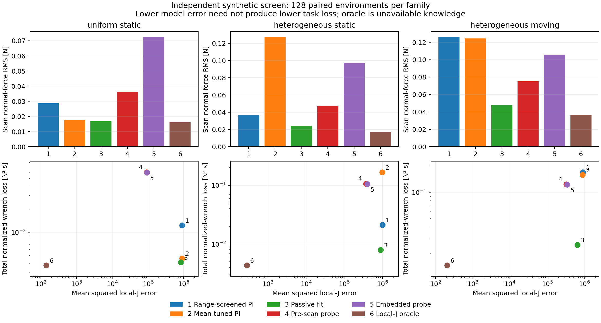

# 扫描中获得的信息，是否值得用、是否值得额外探测？

2026-10-18。候选A的方法形成实验，比较知识、辨识与实际闭环收益。没有超声成像、实机或完整B0验证。理论联系及下一步取舍见[候选A设计](../../研究/候选A_问题与方法设计.md)。

## 载体与公平范围

采用独立于B0柱面Hertz关系的弹性Winkler地基：

\[
p(u)=\kappa(s+u)[z+\theta u-u^2/(2R)-h(s+u,t)]_+,
\quad F=L\int_{-a}^a p(u)du,\quad M=L\int_{-a}^a u p(u)du.
\]

接触长度30mm、横向长度10mm、曲率半径50mm。以 \(x=(z,a\theta)\)、\(y=(F,M/a)\)归一化。扫描80mm、8mm/s；目标3N、零负载一阶矩。测量100Hz、共同20ms延迟，力/矩独立高斯噪声标准差0.03N/0.0003Nm；位置无噪声。法向/转动速度执行器时间常数20/30ms，速度上限20mm/s、0.5rad/s。不是力矩驱动机器人，没有组织黏弹性、摩擦、图像或能量池保证。

材料地基系数随机取1–12MN/m³，异质组乘以平滑过渡因子 exp(c tanh(·))，c∈[−0.65,0.65]；表面有未知空间起伏，运动组另有未知0.15–0.4Hz运动。所有参数及种子见JSON和源码。它们是探索范围，未由某实际平台联合标定。

每个实例从相同的3N/零矩静态平衡位姿开始；这会去掉接触建立难题，不能当完整扫描验证。控制器只能用因果力/矩、位姿与自身历史，不获得材料、表面程序或未来真值。oracle单独获得延迟时刻真实局部Jacobian，既不是可部署方法，也不是全局最优上界。

共同执行直接力—矩PI速度反馈。比较：

| 名称 | 不同之处 |
|---|---|
| 平均调优PI | 固定名义响应 diag(1500,500)N/m；校准集选带宽和积分项 |
| 被动拟合 | 同执行器；用最近0.6秒数据拟合局部2×2响应，消去常数与线性时间漂移，带数据秩阈值、正定投影和正则化 |
| 独立探测 | 被动拟合前，在初始位置额外探测1秒；其误差计入总代价，总时长11秒 |
| 扫描内探测 | 扫描最初1秒叠加相同探测；误差全部计入，总时长10秒 |
| 局部J oracle | 仅将局部响应换为真实值；其他力测量和执行限制相同 |
| 范围筛选PI | 后续补入的强固定参照；先按声明材料范围筛查冻结线性标量环稳定性，再按原校准集误差选择带宽 |

两个探测方案共同采用法向0.2mm/3Hz、归一化转动0.15mm/5Hz的速度正弦激励，经相同执行器；幅值是速度积分对应的开环名义位移，不是实际保证的探测位移。固定幅值/时长未优化，失败不能排除更好的主动策略。

拟合得到的是控制响应矩阵，不是材料/表面真值。线性时间项也不能分离任意表面运动与材料变化。正则化、投影和选择带宽均为成熟简单机制，非新算法贡献。

## 协议、结果与后续强化

首轮用36个校准实例、每种方法18组带宽/积分参数；目标为

\[
J=\int [(F-3)^2+(M/a)^2]dt.
\]

这是几何归一化机械指标，无人为增益目标、材料辨识奖励或成像代理；不能视为唯一正确的任务效用。正/转动分量、峰值和接触丢失另外报告。误差带±0.3N、±0.01Nm只作展示，未作成功率、临床阈值或固定验收条件。

首轮每族128个新实例（共384个）显示平均调优PI有少数振荡尾部，正态均值差区间也受尾部影响。因而补入范围筛选PI；保留首轮全部结果，未覆盖或悄悄替换。

后续选择规则先写入 `followup_protocol.json`，再生成**另一批384个新实例**。先筛选两种执行器时间常数、200个冻结标量响应比下的离散环谱半径，再从合格配置取原校准均值最低者，得到带宽8、积分系数0.3；原平均调优为16、0.3。该筛选不是时变耦合接触的稳定性证明。其他方法沿用首轮参数，没有用新测试集重新训练。配对均值差采用按实例重采样的bootstrap；不把每个控制采样点当独立样本。

下表为后续新实例上的**扫描阶段法向力RMS，单位N**：

| 方法 | 均匀静止 | 异质静止 | 异质运动 |
|---|---:|---:|---:|
| 范围筛选PI | 0.02864 | 0.03674 | 0.12607 |
| 平均调优PI | 0.01767 | 0.12724 | 0.12435 |
| 被动拟合 | 0.01687 | 0.02406 | 0.04824 |
| 独立探测 | 0.03605 | 0.04774 | 0.07538 |
| 扫描内探测 | 0.07245 | 0.09718 | 0.10597 |
| 局部J oracle | 0.01611 | 0.01731 | 0.03639 |

被动拟合相对范围筛选PI的平均总J分别低66.67%、62.54%、85.17%；配对差bootstrap区间均在零下。**绝对误差也要看**，这不是同等幅度的成像或患者获益，更不是超过Xue、UFIC等完整强prior的证据。

这里对比的是整体自适应效果，尚未排除更简单的带宽调度也能获得相同收益；不能由此断言必须恢复物理G或必须采用本拟合器。性能指标使用仿真真实负载，观测只有零均值噪声，无力传感偏置/姿态相关重力补偿误差；实际平台上很小的闭环误差可能被这些误差覆盖。

探测提高了响应模型精度。例如均匀组的J矩阵均方误差，被动拟合约832108、独立探测约90933；但后者总任务损失是前者的14.57倍。异质静止/运动组对应倍数13.29/4.92。扫描内探测也未胜过被动拟合。不能从“需要激励才能辨识”推出“应该额外激励”。

风险没有被平均指标覆盖：被动拟合在异质运动组最坏峰值4.275N，高于范围筛选PI的3.538N；异质静止分别3.714N与3.197N。平均调优固定PI最坏达6.2497N。试验没有强制力上限，这些失利全部保留；速度限幅和正定投影不是安全证明。



## 理论与数值核对

1. **明确的观测歧义实例**：完整覆盖、同一位姿z=3.25mm，均匀地基系数3/6MN/m³、平面高度−/+0.8333mm，两者都产生3N与零矩；局部法向斜率分别900/1800N/m。共同再压0.1mm，力分别3.09/3.18N。它证明该历史下数据不区分两者；不证明任意扫描历史不可辨识，也不是B0附录D.3之外的新奇性发现。
2. 独立自适应积分与Jacobian有限差分96个状态：归一化wrench最大差8.26×10⁻⁴N，Jacobian最大相对差1.689%。有限节点在接触边缘计算导数时比积分更敏感，不把它说成零误差。
3. 用独立力积分、独立编码PI和DOP853执行器重建三条闭环，位置最大差约2.02µm，总代价相对差最大0.442%。不是复放原动作。
4. 原61积分点/5子步细化为241点/20子步，同100Hz观测与控制、同噪声，抽取每族前8例及全部5原方法；平均J变化最大2.66%（被动拟合、异质运动）。已检查范围不改变探测劣于被动拟合的排序；不足以认证所有极端实例或真实接触模型。

## 取舍

保留“扫描中获得少量控制相关信息”的方法假设；优先采用成熟直接反馈与被动在线适应作为后续共同执行层/强对照。额外探测只应在真实任务损失支持时形成候选，不能因信息矩阵更好就保留。当前无证据支持固定探测作为主线，也没有得到新的顶刊贡献。

这个载体已经回答机制层问题，不继续通过加陡表面、压低反馈带宽或添加人工目标制造收益。应转向真实采集任务所需的能力与剩余困难；阶段性机械收益不能证明减少预表征后仍保持图像/体积结果。未比较全维B0、NEOC或PPO，不将本轮任务设成它们的固定门槛。

## 复现

使用根目录NumPy/SciPy/Numba依赖；画图另需Matplotlib。依次运行：

```bash
python -X utf8 实验/扫描接触信息判别/screen.py
python -X utf8 实验/扫描接触信息判别/verify.py
python -X utf8 实验/扫描接触信息判别/robust_reference.py
python -X utf8 实验/扫描接触信息判别/plot.py
```

`results.json`、`paired.npz`保存首轮；`followup*`保存强化参照后的独立新实例，后者不是首轮未接触测试集的事先预注册实验。JSON保存协议、全部参数选择、脚本哈希与必要原始指标，NPZ保存逐实例指标和预先按索引选的代表轨迹。不要用后续选择规则假称首轮完全事先确定。
